<p align="center">
  
</p>

# Central RGB

<p align="center">
  <a href="https://github.com/steven-t0764/CentralRGB/releases/latest/download/CentralRGB-Setup.exe"></a>
  <a href="https://github.com/steven-t0764/CentralRGB/releases/latest"></a>
  
  
</p>


A free and open-source Windows desktop app that controls **all the RGB lighting in your PC from one place**, and also handles **fan control** and **system monitoring**. Central RGB finds your hardware automatically, sets up the drivers and engines it needs, and lets you change every device's color at once.

- **Finds your RGB hardware automatically**: motherboards, graphics cards, RAM, LED strips, coolers, keyboards, mice and more
- **Sets every device at once** with a color wheel, swatches, RGB values, brightness and speed. Five basic effects (Static, Breathing, Color Cycle, Rainbow Wave, Off) plus a **preset gallery** of 16 effects with picture previews: Tide, Drizzle, Sweep, Ember, Pulse, Drift, Volt, Frost, Aurora, Supernova, Cascade, Cyberpunk, Magma, Stardust, Nebula and Eclipse
- **Per-device lighting**: click Customize on a device to see a model of it (RAM stick, graphics card, fans, cooler, keyboard, mouse, board) lit with its live colors, plus its exact model details, and give it its own effect, color and brightness
- **Fan control** with Silent, Balanced, Performance and Max profiles, or a **custom fan curve you drag into shape**, with built-in safety limits
- **System monitor**: live CPU, GPU and memory gauges, network and storage graphs, and an **Advanced** view with every hardware sensor and full system details
- **Profiles** to save your favorite looks and switch between them in one click
- **In-game FPS overlay**: just the number, no box, in the Orbitron font. It turns green when the game is smooth (60+), amber when it dips (30–59) and red when it's low (under 30). Optional 1% low, frame time and CPU/GPU temperatures, measured with Intel PresentMon (nothing is injected into the game)
- **A compact, quiet interface**: the default **Gunmetal** theme keeps every panel neutral so only your real lighting brings the colour, and the sidebar marks the open page with one lit LED in your current lighting colour
- **9 themes** (Gunmetal, Cyber Cyan, Ultraviolet Pulse, Emerald Matrix, Crimson Overclock, Nebula Glass, Tactical Mech, Bio-Neural, Cyber Glitch), each in **Dark** or **Light** appearance, that switch instantly, no restart. Smooth, anti-aliased dials, graphs, cards and buttons, and a startup animation with the logo
- **Clears conflicts for you**: when another RGB app (MSI Mystic Light, iCUE, Armoury Crate...) is holding your hardware, the Devices page offers to close it and re-detect your devices
- **Lives in the system tray**: closing the window keeps your lighting and fan control running; right-click the tray icon to open or quit
- **Edit by device type**: chips on the Lighting page (All Devices, RAM, GPU, Motherboard...) let you set the lighting for every device or just one kind
- **Starts with Windows** (optional) and reapplies your lighting and fan profile at login
- **Normal Windows installer**: choose where to install it, and get a desktop shortcut and an uninstaller

> [!NOTE]
> The screenshots and demo below were captured with **simulated demo hardware**, so device names and sensor readings are examples. Which devices and fans Central RGB can control on your PC depends on support in [OpenRGB](https://openrgb.org) and [LibreHardwareMonitor](https://github.com/LibreHardwareMonitor/LibreHardwareMonitor). If something isn't detected, please open an issue.

---

## See it in action

<p align="center">
  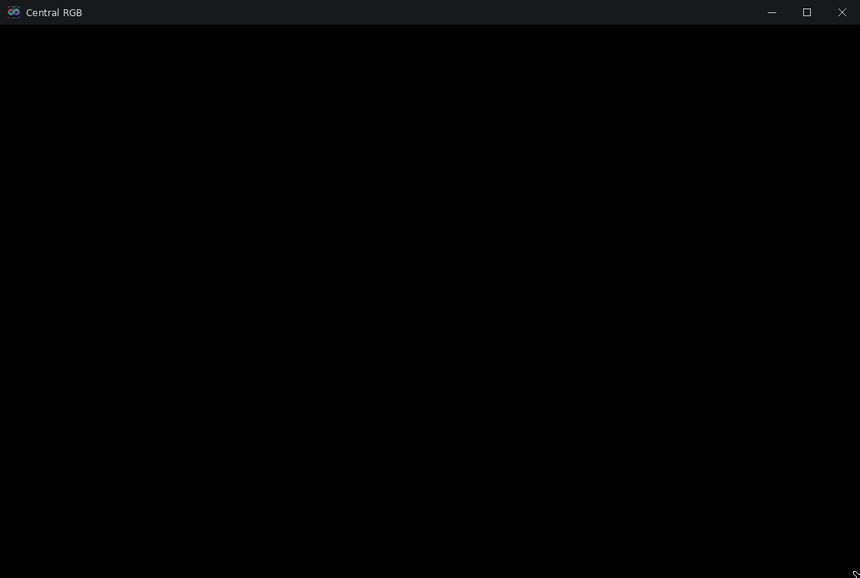
</p>

---

## Download

Grab the latest version from the [**Releases page**](../../releases/latest):

| File | What it is |
|---|---|
| [`CentralRGB-Setup.exe`](../../releases/latest/download/CentralRGB-Setup.exe) | **Installer (recommended).** A standard setup wizard: you choose the install folder, it **installs the PawnIO driver for you** if it's missing, and it adds Start-menu and desktop shortcuts, an optional start at login, and an uninstaller under *Settings → Apps*. |
| `Central RGB.exe` | **Portable.** One file that runs from anywhere with no install. |

Run it and click **Yes** on the administrator prompt. Central RGB needs admin rights to reach RAM, motherboard lighting and fan controllers.

### What the installer does about PawnIO

1. Checks whether the PawnIO driver is already installed (it looks for the `PawnIO` Windows service).
2. If it's missing, shows a ticked **"Install the PawnIO driver"** option.
3. Downloads the **official, signed** installer from the link on [pawnio.eu](https://pawnio.eu)
   (`github.com/namazso/PawnIO.Setup/releases/latest`). It isn't bundled, so you always get the latest version.
4. Runs it silently (`PawnIO_setup.exe -install -silent`) and asks you to restart if the driver needs one.
5. If the download fails, Central RGB still installs and tells you where to get PawnIO.

Uninstalling Central RGB **leaves PawnIO installed**, because other tools (OpenRGB, FanControl, LibreHardwareMonitor) use it too.
You can remove it separately from *Settings → Apps*.

### Updating

- **In the app (one click):** Central RGB checks GitHub for a new release at most once a day (turn this off with
  **Settings → Updates → Automatically check for updates**, or press **Check now** any time). When a newer version
  exists, a small notice offers **Update now** or **Later**. *Update now* downloads the right file (the installer for an
  installed copy, `Central RGB.exe` for the portable copy), checks it against the `SHA256SUMS.txt` published with the
  release and refuses it if it doesn't match, closes Central RGB the normal way (fans go back to BIOS control), installs
  it silently and opens the new version. Pre-releases and test builds are never offered.
- **Fresh download:** the newest installer is always at
  [`releases/latest/download/CentralRGB-Setup.exe`](https://github.com/steven-t0764/CentralRGB/releases/latest/download/CentralRGB-Setup.exe).
  Running it over an existing install keeps your settings.


---

## Requirements

| Requirement | Why |
|---|---|
| Windows 10 (1803+) or Windows 11, 64-bit Intel/AMD PC (ARM PCs aren't supported) | Hardware access and the window styling are Windows-only |
| Administrator rights | Needed for RAM and motherboard lighting, sensors and fan control. The .exe asks for them automatically. |
| [PawnIO](https://pawnio.eu) driver | Low-level driver used by OpenRGB and LibreHardwareMonitor for RGB RAM, older motherboards, fan control and most temperature sensors. **The installer sets it up for you.** If you use the portable .exe, install it yourself from pawnio.eu. |
| .NET Framework 4.7.2+ | Already built into Windows 10 and 11. Used to load LibreHardwareMonitor. |
| Internet on first run | Central RGB downloads OpenRGB (≈15 MB) and LibreHardwareMonitor the first time |

> [!TIP]
> Close other RGB and fan apps (Corsair iCUE, ASUS Armoury Crate, MSI Mystic Light, Gigabyte RGB Fusion, NZXT CAM, SignalRGB, Razer Synapse, Logitech G HUB and others). They fight over the same hardware. **Settings → System check** tells you if any of them are running.

### DDR5 RGB RAM

Central RGB lights DDR5 RGB RAM only through OpenRGB, the same way as DDR4: it never writes to the RAM's SPD or SMBus itself. What works depends on OpenRGB.

- **OpenRGB 1.0 or newer with PawnIO is needed.** Central RGB downloads the newest stable OpenRGB from openrgb.org on first run (or uses the one you installed). Older OpenRGB versions used the WinRing0 driver, which Windows 11 blocks; the Devices page then says **DDR5 RAM not supported by this OpenRGB**.
- **DDR5 RGB kits Central RGB recognises** (whether OpenRGB lights one depends on the OpenRGB version, the kit *and* the board; check [openrgb.org/devices.html](https://openrgb.org/devices.html)): Kingston FURY Beast / Renegade RGB DDR5, Corsair Vengeance RGB DDR5 and Dominator Platinum / Titanium RGB DDR5, G.Skill Trident Z5 RGB / Z5 Neo RGB, TeamGroup T-Force Delta RGB DDR5 and XPG Lancer RGB DDR5. OpenRGB reaches them over the motherboard's SMBus through PawnIO on both Intel (i801) and AMD (piix4) boards.
- **Once per boot.** On many PCs OpenRGB only finds DDR5 RGB RAM on its first hardware search after the PC starts, and searching again can make the sticks unreadable until a full shutdown. So with DDR5, Central RGB starts its hidden OpenRGB once and keeps it running (also after you close the app), **Rescan** asks before searching again, and **Close them** doesn't restart OpenRGB once the RAM is found.
- **If the RAM isn't found**: shut the PC down fully (hold Shift while you click Shut down, so Fast Startup doesn't skip the power-off), turn it on and open Central RGB before any other RGB app. The **DDR5 RGB RAM not detected** note on the Devices page lists what's blocking it (admin rights, PawnIO, MSI Center / iCUE / another app holding the SMBus, an earlier search this boot). If nothing is blocking it and it's still missing after a full shutdown, OpenRGB doesn't support that kit on that board yet, and Central RGB can't light it either.
- Once found, the sticks get every effect, one stick at a time on the shared bus at the steady RAM rate, using their own Static, Breathing and Color Cycle modes where they have them.

---

## Screenshots

<p align="center">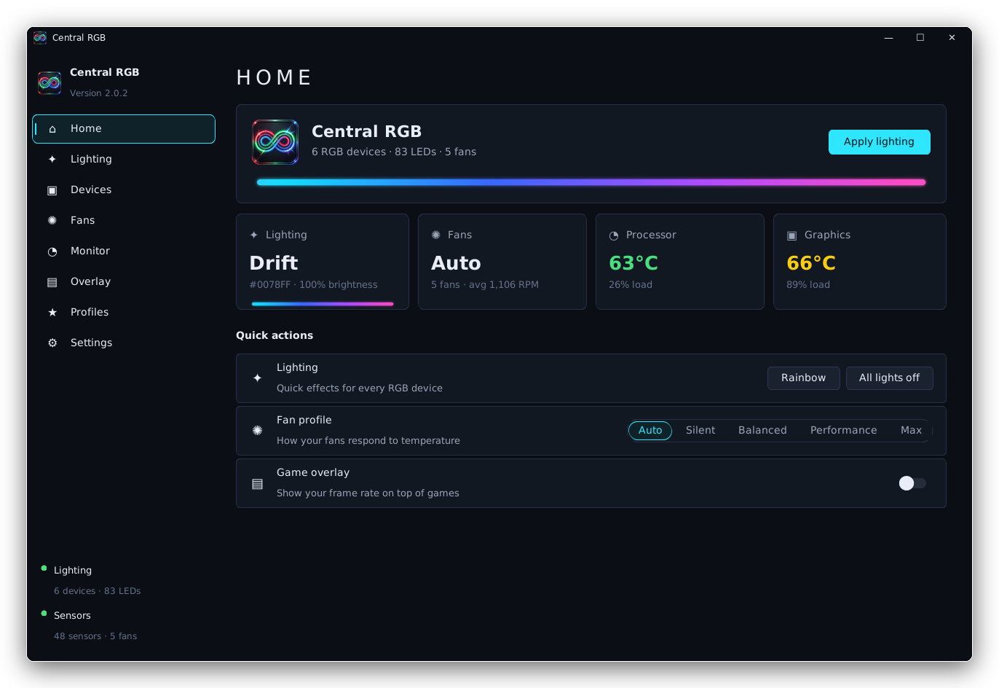<br><b>Home</b>: devices, live lighting, fan profile and temperatures at a glance, with quick actions</p>

<p align="center">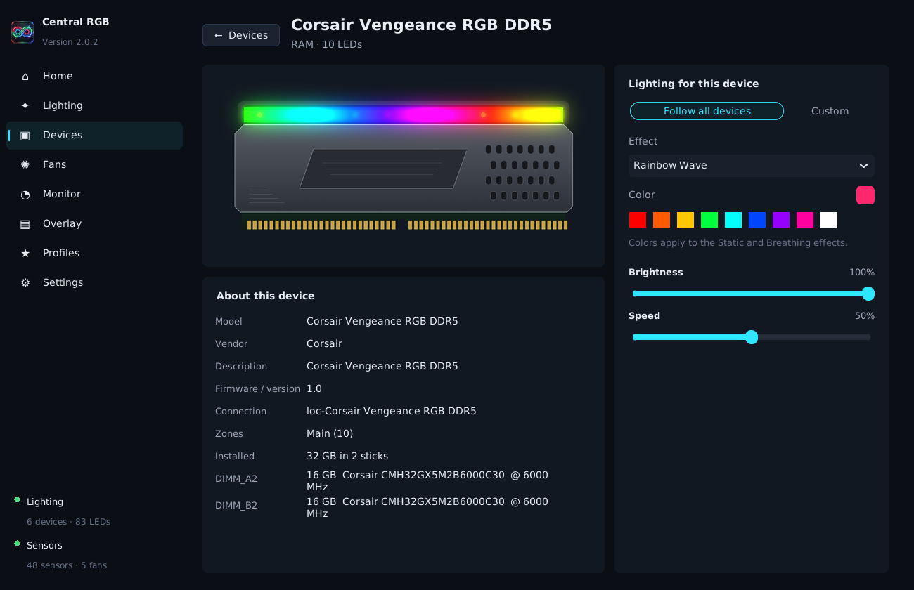<br><b>Device editor</b>: a model of the device lit with its live colors, its exact model details, and its own lighting</p>

<table>
  <tr>
    <td width="50%">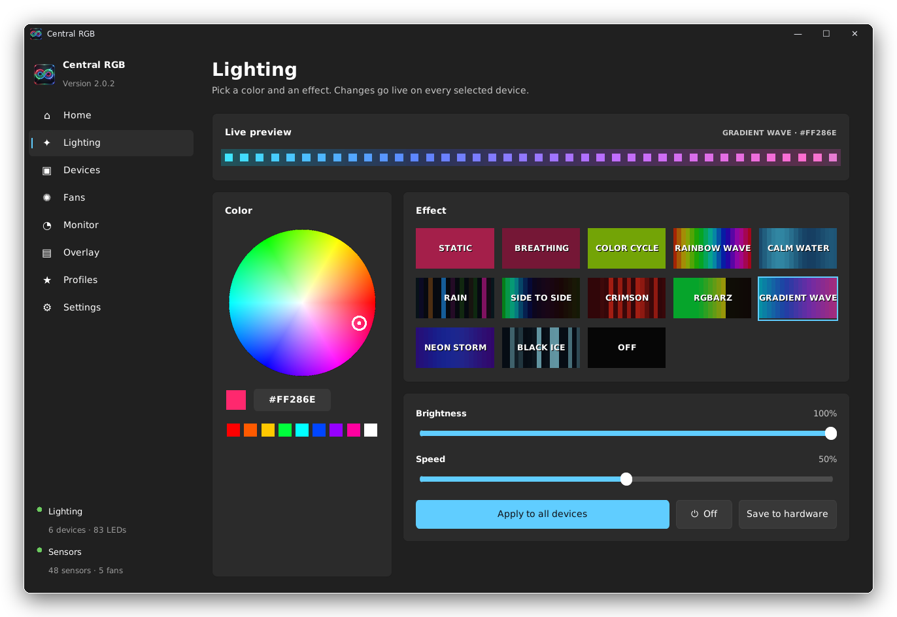<br><b>Lighting</b>: color wheel, presets, effect tiles with live previews, brightness and speed</td>
    <td width="50%">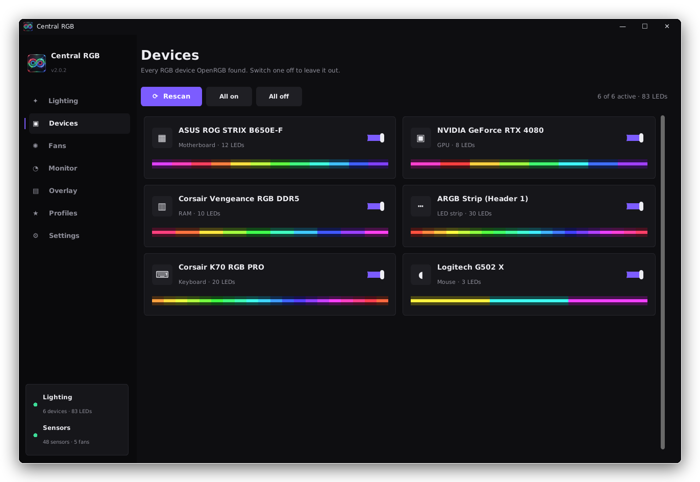<br><b>Devices</b>: every RGB device found, each with its own switch and live LEDs</td>
  </tr>
  <tr>
    <td>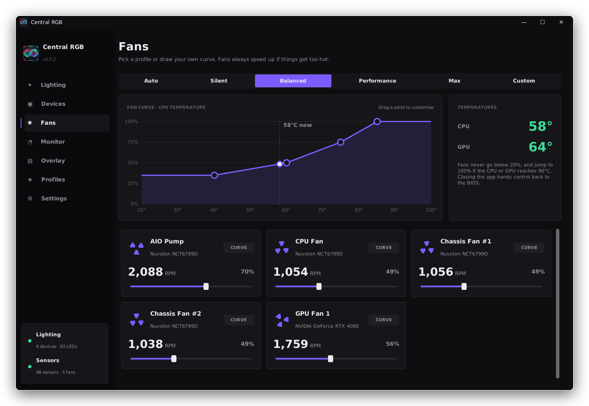<br><b>Fans</b>: profiles, a drag-able fan curve, live temperatures and per-fan control</td>
    <td>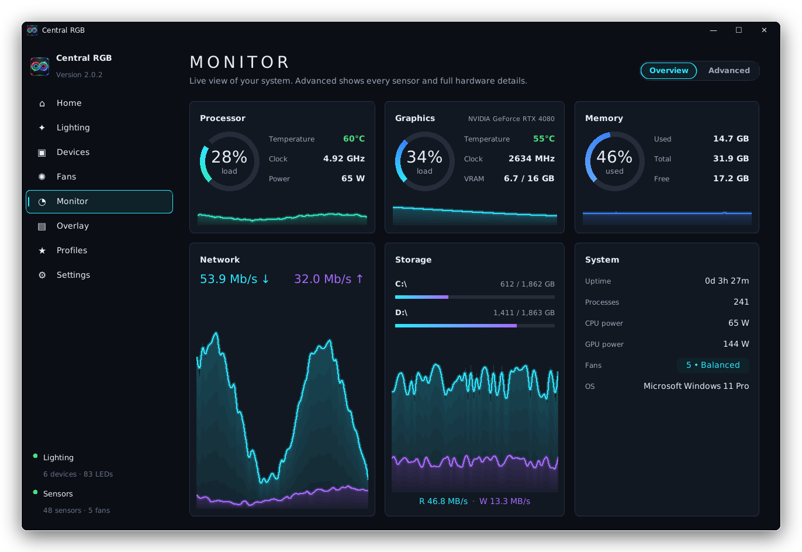<br><b>Monitor</b>: CPU, GPU and memory at a glance, one big live load chart, network, storage and system stats</td>
  </tr>
  <tr>
    <td>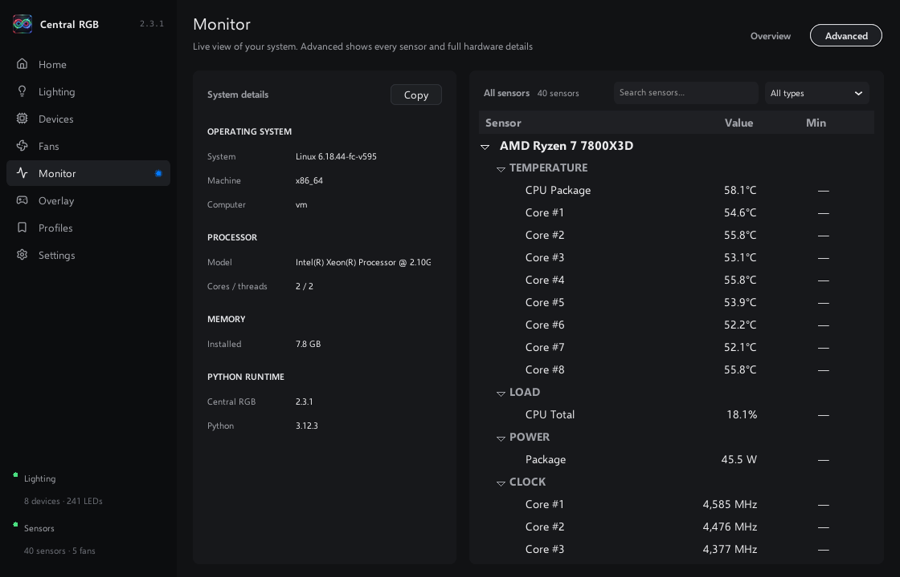<br><b>Monitor → Advanced</b>: every sensor (value / min / max) plus full system details</td>
    <td>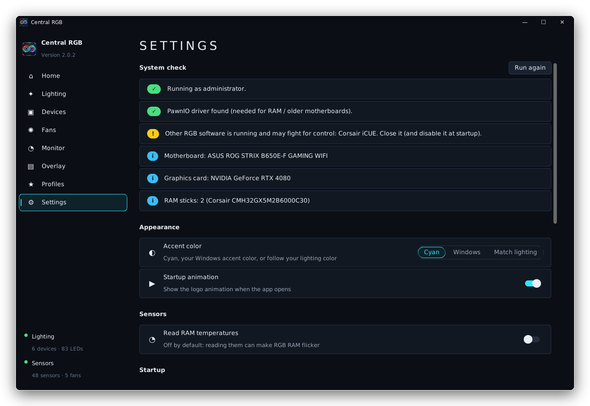<br><b>Settings</b>: system check, accent color, sensor, startup and update options, and an activity log</td>
  </tr>
  <tr>
    <td>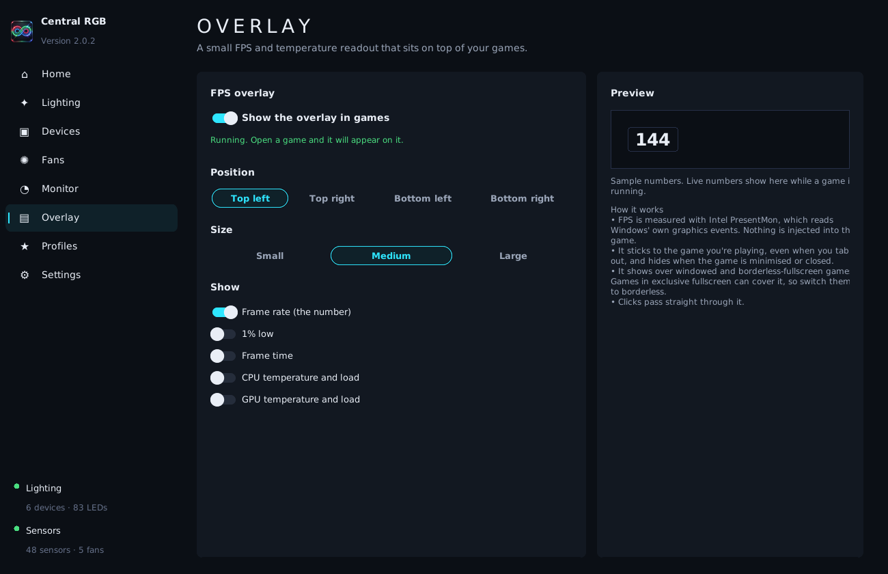<br><b>Overlay</b>: in-game FPS and temperature readout with position, size and item options</td>
    <td>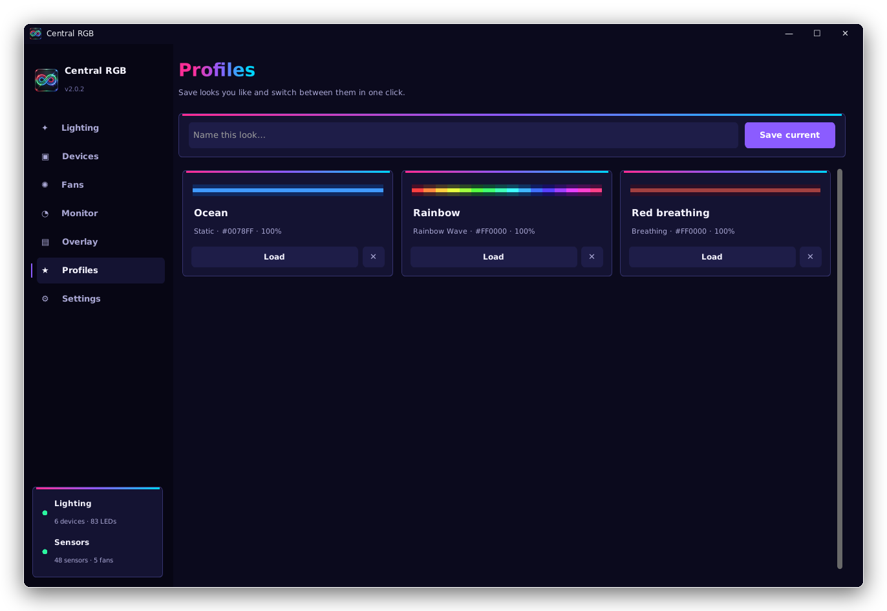<br><b>Profiles</b>: save a look and load it again in one click</td>
  </tr>
</table>

---

## How it's built

Central RGB is written in Python. It's split into four modules, each with one job, and it uses two open-source hardware engines that it downloads and runs for you.

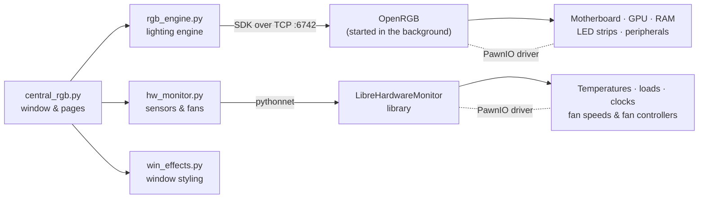

### 1. The window: `central_rgb.py`

A [CustomTkinter](https://github.com/TomSchimansky/CustomTkinter) app with a sidebar and six pages. Pieces like the color wheel, LED strips, fan curve editor, ring gauges and graphs are custom-drawn on canvases, so they can animate smoothly.

- A navy palette with cyan and purple accents. **Settings → Accent color** switches between Cyan (default), your Windows accent color, or your lighting color.
- Slow work (starting OpenRGB, downloads, the system check) runs on background threads. Results come back to the window through a queue that's checked every 100 ms, so the window never freezes.
- **Settings → Appearance** switches every theme between Dark (default) and Light: bright panels, dark text and a deeper shade of the theme's accent, with a light title bar on Windows. It applies straight away, without a restart.
- Everything you change is saved instantly to `%APPDATA%\CentralRGB\settings.json`.

### 2. Lighting: `rgb_engine.py`

**Finding and starting OpenRGB (`OpenRGBManager`)**

1. Checks whether OpenRGB's SDK server is already listening on `127.0.0.1:6742`.
2. If not, looks for `OpenRGB.exe` next to the app, in Program Files, in `%LOCALAPPDATA%\Programs` and in its own download folder.
3. If it can't find one, it offers to **download the newest Windows build** automatically. It reads the official releases page and falls back to a known 1.1 link. Every path inside the zip is checked before extracting.
4. Starts it hidden in the tray with the SDK server turned on:

```text
OpenRGB.exe --server --noautoconnect
```

5. Waits for the server, connects with [openrgb-python](https://github.com/jath03/openrgb-python), then rescans after 4 s and again after 12 s, because OpenRGB keeps detecting devices for a while after it starts.

**Driving the lights (`LightingEngine`)**

A background thread pushes frames to every selected device:

- Each device is switched to its most controllable mode, in this order: `Direct`, then `Custom`, then `Static`.
- Devices that take **per-LED colors** are updated at **30 frames per second**. Devices that only take one color per mode (some RAM, for example) are limited to 2 updates a second, because they're slow to change.
- A device that throws an error is skipped until the next rescan, so one bad device can't stall the rest.
- `compute_colors()` produces every effect from color, brightness, speed and time. **Rainbow Wave** shifts the hue across each device's LEDs and offsets each device slightly, so the colors flow from one device to the next.
- **Save to hardware** writes the current static color into each device's own memory where supported, so it stays even with the app closed.

**System check (`system_check()`)** looks at admin rights, the PawnIO driver (service or install folder), running vendor RGB apps (from `tasklist`), and your motherboard, GPU and RAM models, mice and keyboards (from PowerShell `Get-CimInstance`). After hardware detection, the Devices page compares those with what OpenRGB found and explains any RGB RAM or RGB mouse it missed.

### 3. Sensors & fans: `hw_monitor.py`

**Loading LibreHardwareMonitor (`LHMBackend`)**

1. Downloads the latest LibreHardwareMonitor release (the .NET Framework build) into `%LOCALAPPDATA%\CentralRGB\LHM` the first time.
2. Starts .NET with [pythonnet](https://github.com/pythonnet/pythonnet). It tries `netfx` first, then `coreclr`.
3. Hooks `AppDomain.AssemblyResolve`, so LibreHardwareMonitor's dependency DLLs load from its own folder.
4. Turns on the CPU, GPU, motherboard, controller, storage, network and PSU sensors. **RAM temperature sensors are off by default.** LibreHardwareMonitor reads them over the SMBus, the same bus OpenRGB uses for RGB RAM, and polling it makes RGB RAM flicker. You can turn them on in Settings if you don't have RGB RAM.

All library calls happen on **one worker thread** (LibreHardwareMonitor isn't thread-safe). The window reads a snapshot from it every second. If the library can't load, the Monitor page still shows basic stats from `psutil`.

**Fan control logic (runs every second)**

```python
FAN_FLOOR = 20        # never drive a fan below 20 %
PUMP_FLOOR = 70       # anything named "pump" never goes below 70 %
EMERGENCY_TEMP = 90   # CPU or GPU at 90 °C or more -> every fan to 100 %
```

1. Each fan controller is paired with its RPM sensor, and with the **GPU temperature** (GPU fans) or the **CPU temperature** (everything else).
2. The target speed comes from, in order of priority: the emergency override, then your manual slider, then the active profile's curve.
3. Speeds **rise instantly** but **fall by at most 4 % a second**, so fans don't rev up and down.
4. **Auto** hands every fan back to the BIOS. Closing the app does the same.

| Profile | Fan curve (°C → speed) |
|---|---|
| **Auto** | BIOS / firmware control |
| **Silent** | 40° → 25% · 60° → 35% · 75° → 60% · 85° → 100% |
| **Balanced** | 40° → 35% · 60° → 50% · 75° → 75% · 85° → 100% |
| **Performance** | 40° → 50% · 60° → 70% · 70° → 90% · 80° → 100% |
| **Max** | 100% all the time |
| **Custom** | Your own 4-point curve. Drag the points on the graph. |

**System details (`system_info()`)** collects your Windows version and build, CPU (cores, threads, cache, socket), motherboard and BIOS, every RAM stick (slot, size, part number, speed), GPUs and driver versions, display resolution, disks and network adapters, all in one PowerShell CIM query.

### 4. Window styling: `win_effects.py`

- Dark title bar on Windows 10 and 11 (`DWMWA_USE_IMMERSIVE_DARK_MODE`).
- On Windows 11 the title bar, caption text and window border are painted in the app's own colors
  (`DWMWA_CAPTION_COLOR`, `DWMWA_TEXT_COLOR`, `DWMWA_BORDER_COLOR`), so the window looks like one seamless surface.
- Rounded window corners on Windows 11.
  That's why the solid theme is the default.

---

## Usage

1. **Run the installer** and leave **"Install the PawnIO driver"** ticked. It only appears if PawnIO isn't installed yet. Restart if setup asks you to.
2. **Open Central RGB** and accept the admin prompt.
3. On first launch, let it **download OpenRGB** (click *Yes*). Hardware detection takes about 30 seconds the first time.
4. Open **Devices** to check that everything was found, then go to **Lighting**, pick a color and effect, and press **Apply to all devices**.
5. On **Fans**, start with **Balanced**, or drag the curve points to make your own.
6. Optionally turn on **Settings → Start with Windows**.

| Page | What you can do |
|---|---|
| Home | See your devices, current lighting, fan profile and CPU/GPU temperatures. Quick actions: Rainbow, all lights off, fan profile, game overlay on/off |
| Lighting | Color wheel, hex code, 18 color swatches, 16 preset effects, 5 basic effects, brightness, speed, apply to all devices, save to hardware |
| Devices | See every device and its LED count, switch devices on or off, rescan |
| Fans | Profiles, custom curve, live CPU and GPU temperatures, a manual slider per fan (tap **MANUAL ↺** to go back to the curve) |
| Monitor → Overview | CPU / GPU / RAM gauges and graphs, network up/down, drive usage, uptime, power draw |
| Monitor → Advanced | Search and filter every sensor, copy full system details to the clipboard |
| Overlay | A small pill that shows your frame rate as a plain number, pinned to a corner of the game window. It stays on the game when you tab out and hides when the game is minimized or closed. Optional extras: 1% low, frame time, CPU and GPU temperature. Works over windowed and borderless-fullscreen games; exclusive fullscreen can cover it. |
| Profiles | Save the current look under a name, then load or delete it later |
| Settings | System check, theme, appearance (Dark or Light), accent color (Cyan, Windows or match lighting), startup animation, RAM temperature reading, start with Windows, reapply lighting on launch, activity log |

> [!IMPORTANT]
> Animated effects and custom fan profiles only run while Central RGB is open. Closing the window offers to **minimize instead**. If you quit, the lights stay on their last frame and the fans go back to BIOS control.

### Start with Windows

Windows won't start apps that need admin rights from the normal Startup folder, so Central RGB uses **Task Scheduler**. It creates a task called `CentralRGB` that runs at login with highest privileges, 20 seconds after sign-in, using `--background` (starts minimized and reapplies your lighting). You can switch it on from the installer or from **Settings**.

---

## Building from source

1. Install **Python 3.12** from [python.org](https://www.python.org/downloads/) and tick **"Add python.exe to PATH"**.
2. Optional: install **Inno Setup** for the installer (`winget install JRSoftware.InnoSetup`).
3. Double-click **`build.bat`**. It installs the dependencies, packages the app with PyInstaller, and builds the installer:

```text
dist\Central RGB.exe                    portable app
installer\CentralRGB-Setup.exe          setup wizard
```

To run it straight from source instead, open an **administrator** terminal and run:

```powershell
py -m pip install -r requirements.txt
py central_rgb.py
```

**GitHub Actions**: every push to `main` builds the .exe, **launches it on a clean Windows machine as a self-test** (it opens every page, runs the system check and fails the build if anything crashes), then builds the installer (see `.github/workflows/build.yml`). Publishing a GitHub Release builds both files and attaches them to it, using the release tag as the version number (tag `v2.1` → app and installer show 2.1).

---

## Troubleshooting

| Problem | Fix |
|---|---|
| RGB RAM or motherboard lighting is missing | If the Devices page shows **Other RGB software is running**, press **Close them** (on MSI boards, Mystic Light holds the motherboard and RAM lighting; all MSI Center services and LEDKeeper2 are stopped, then your devices are re-detected once). The **RGB RAM not detected** note under it lists every cause it found: not admin, no **PawnIO** (rerun the installer, or get it from pawnio.eu), an OpenRGB older than 1.0, or an OpenRGB you started yourself (quit it, then press **Rescan**). Give it about 30 seconds |
| DDR5 RGB RAM is missing | See [DDR5 RGB RAM](#ddr5-rgb-ram): DDR5 lighting is usually only found on the first search after a full shutdown. Shut down fully (Shift + Shut down), turn on, open Central RGB first. The Devices page says when OpenRGB doesn't support the kit |
| An RGB mouse is missing | The Devices page shows **Mouse not detected** with the mouse's USB ID. If its own app (SteelSeries GG, Razer Synapse, G HUB, iCUE) is running, press **Close them** and keep that app from starting with Windows. If it still doesn't show, OpenRGB doesn't support that model yet: check openrgb.org/devices.html |
| A device keeps changing back to its old color | Another RGB app is running. Close it and turn off its auto-start. |
| "OpenRGB closed right after starting" | A copy of OpenRGB is already open without its SDK server. Close it from the system tray and press **Rescan**. |
| Fans page says no controllable fans | Your motherboard's fan chip may not be supported yet, or its fans are set to a fixed mode in the BIOS |
| Monitor shows "Basic stats only" | LibreHardwareMonitor couldn't load. Check the Settings → Activity log, and confirm PawnIO is installed and you're running as admin. |
| RGB RAM blinks or flickers | Leave **Settings → Read RAM temperatures** off (the default). Reading DIMM temperatures uses the same SMBus that controls RAM lighting. Also close other monitoring tools that read RAM temps (HWiNFO, AIDA64, etc.). |
| Antivirus flags the .exe | New PyInstaller builds are sometimes flagged by mistake. Allow the file, or run from source. |

---

## Project structure

```text
CentralRGB/
├── central_rgb.py        # window, pages and custom widgets
├── rgb_engine.py         # OpenRGB setup, lighting effects, system check, settings
├── hw_monitor.py         # LibreHardwareMonitor sensors, fan logic, system details
├── fps_overlay.py        # in-game FPS overlay (PresentMon)
├── fonts/                # Orbitron for the FPS counter (OFL 1.1, with its license)
├── presets/              # preview pictures for the preset effects (made by tools/make_preset_art.py)
├── win_effects.py        # dark, seamless title bar
├── updater.py            # one-click updates from GitHub Releases (checksum-verified)
├── central_rgb.ico/.png  # app icon
├── central_rgb.iss       # Inno Setup installer script
├── build.bat             # one-click build (exe + installer)
├── requirements.txt
├── .github/workflows/build.yml
└── assets/               # banner, demo and screenshots for this README
```

---

## Built with

| Project | Used for |
|---|---|
| [OpenRGB](https://openrgb.org) | Talking to RGB hardware. GPL-2.0, downloaded on first run and run as a separate program, not bundled. |
| [LibreHardwareMonitor](https://github.com/LibreHardwareMonitor/LibreHardwareMonitor) | Sensors and fan control. MPL-2.0, downloaded on first run, not bundled. |
| [PresentMon](https://github.com/GameTechDev/PresentMon) | FPS measurement for the overlay. MIT, downloaded the first time the overlay is turned on. |
| [Orbitron](https://github.com/theleagueof/orbitron) | The FPS counter's font, by Matt McInerney. SIL Open Font License 1.1, bundled unmodified in `fonts/` with its license. |
| [PawnIO](https://pawnio.eu) | Low-level hardware access driver. The setup downloads and installs it if missing. |
| [CustomTkinter](https://github.com/TomSchimansky/CustomTkinter) | Modern widgets |
| [openrgb-python](https://github.com/jath03/openrgb-python) | OpenRGB SDK client |
| [pythonnet](https://github.com/pythonnet/pythonnet) · [psutil](https://github.com/giampaolo/psutil) · [Pillow](https://python-pillow.org) | .NET bridge · system stats · images |

> [!WARNING]
> Fan control changes how your PC cools itself. Central RGB has safety limits (minimum speeds, a 90 °C override, and handing control back to the BIOS on exit), but use custom curves carefully and keep an eye on your temperatures.

---

## Contributing

Bug reports, device reports and pull requests are welcome. See [CONTRIBUTING.md](CONTRIBUTING.md) for how to run from source,
what to include in an issue (it helps a lot to paste the **Settings → Activity** log and your hardware list from
**Monitor → Advanced → Copy**), and how to send a change. The full log is also saved as
`%APPDATA%\CentralRGB\activity.log`.

## License

Central RGB is free software, released under the **GNU General Public License v3.0 or later**. See [LICENSE](LICENSE).

You can use, study, share and change it. If you distribute a modified version, it must stay open source under the same
license. OpenRGB (GPL-2.0) and LibreHardwareMonitor (MPL-2.0) are separate projects with their own licenses. Central RGB
downloads them on first run and doesn't bundle them.
